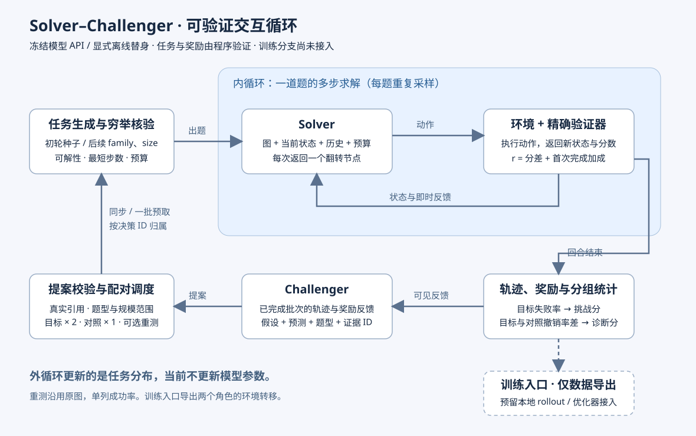

# Bicolor Loop

**Challenger 能从 Solver 的一次失败中，预测它下一次会在哪一步出错吗？** 这个项目用二染色修复题检验这个问题。Solver 每次翻转一个节点，程序立即计算得分。Challenger 读取已完成的轨迹，引用具体回合，预先写下行为预测，再选题检验。两个角色可以使用冻结的模型 API，也可以用本地规则跑通相同的环境和记分逻辑。



## 先看一次真实交互

克隆仓库后，用浏览器打开 [两轮对抗动画](docs/targeted-case.html)。上图固定展示两边正在交换什么，下图逐步播放当时的题面、动作和得分。空格播放或暂停，方向键逐步查看。这个 HTML 可离线打开。

种子批里，Solver 解出了一道桥形题，却在链形题上耗尽预算。接下来两份提案都选了同规模的桥形题。发生变化的是 Challenger 引用的证据和它提前写下的预测。

| 提案 | 依据与预测 | 新题上的实际动作 | 验证结果 |
| --- | --- | --- | --- |
| 第一次 | 引用成功的桥形题，预测 Solver 能承受首步掉分并解出 | `6 → 6 → 8 → 8 → 0`，五步耗尽 | Solver 累计奖励 −1/9，挑战分 1，预测命中 0/1 |
| 第二次 | 引用上一次失败，预测 Solver 掉分后会立刻翻回同一节点 | `6 → 6 → 9 → 9 → 6`，两次撤销，五步耗尽 | Solver 累计奖励 −1/3，挑战分 1，预测命中 1/1 |

两次出题都拿到了挑战分，只有第二次预测命中。一局内撤销两次按一局命中计。第二次提案只有一条可引用轨迹，也没有新的配对对照，诊断分留空。案例记录的服务模型标识为 `gpt-5.6-luna`。第二道新题沿用已保存的首步，第 4 步曾因输出截断而中断，续跑时把输出上限从 1,024 调至 4,096。该案例可以审计反馈如何回流，不能据此估计成功率或训练收益。

在仓库根目录执行下面的命令，即可用录制的输入和回答重算两轮，模型调用数为零。

```sh
python3 -m bicolor.case_replay examples/targeted-case.json --handoff examples/feedback-handoff.json --outcome examples/second-outcome.json
```

## 运行自己的闭环

需要 **Python 3.11+**，只用标准库。默认配置运行两轮同步交互。每次实验使用新的输出目录。

```sh
python3 -m bicolor --mode offline --output runs/demo
python3 -m bicolor.replay --run runs/demo
```

第一次生成题目、执行两轮并保存记录。第二次从记录重算，预期返回 `status: passed`、`rounds: 2`、`model_calls: 0`。在 `runs/demo` 中打开 `decision-0.json` 可看 Challenger 实际拿到的轨迹与提案，`episodes.jsonl` 可看 Solver 的逐步奖励，`rounds.jsonl` 可核对提案如何结算。Windows 可将 `python3` 换成 `python`。

**接入模型 API。** 在 [config.toml](config.toml) 填写兼容 Chat Completions 的 `base_url` 和账号可用的两个模型标识。客户端从环境读取 `BICOLOR_API_KEY`。macOS 或 Linux 首次配置可将 [.env.temp](.env.temp) 复制为 `.env`，在本机填入密钥，然后运行：

```sh
set -a
. ./.env
set +a
python3 -m bicolor --mode api --output runs/api-demo
python3 -m bicolor.replay --run runs/api-demo
```

服务需接受 `model`、`messages`、`max_completion_tokens`，并在 `choices[0].message.content` 中返回 JSON 对象。默认两轮、每轮三题、每题采样两次，最多 37 次角色请求，配置的硬上限为 64 次。调用异常会保留已有轨迹并停止。`.env` 和 `runs/` 均由 Git 忽略。

## 两个角色怎样计分

| 量 | 从什么事实计算 |
| --- | --- |
| Solver 逐步奖励 | 满足边的比例之差 `S(新状态) − S(原状态)`。首次全部满足时再加完成奖励，默认 +1，并立即结束回合 |
| Challenger 挑战分 | 当前提案的有效目标题中，Solver 耗尽预算的比例。种子批没有提案归属。无效或不完整的评价不会填成数值奖励 |
| Challenger 诊断分 | 提案提前预测“掉分后立即撤销”且两组均可评价时，取目标题行为命中率减去对照题行为命中率 |

`bridge` 和 `chain` 在同规模下有相同的节点数、初始分和最短解长度。程序穷举满分着色，检验每道题的最短修复距离。六节点时，两类题都需要恰好三步。桥形题的成功路径可以是 `4/5 → 3/5 → 4/5 → 5/5`，链形题则可以是 `4/5 → 4/5 → 4/5 → 5/5`。这使“暂时掉分后能否继续”成为一个可从轨迹检验的假设。相同题型和规模下主要变化是节点编号，两组的度数分布也有差异。更多定义见 [课程与反馈](docs/curriculum.md)。

## 同步、异步和旧题重测

每批生成两道目标题和一道另一题型的对照题。轮号从 0 开始。

- **同步**（`schedule_mode = "sync"`）等 Solver 解完整批再出题。第 2 轮可依据第 1 轮的反馈。
- **异步**（`"async"`）用容量为一批的题单队列。Solver 取走第 1 批便释放备题位置，Challenger 可复用第 0 轮反馈准备第 2 批。第 3 批才读取第 1 轮反馈。每份提案有独立的 `decision_id`。
- **重测**默认关闭。从 `historical_start_round` 起，每批最多随机加入 `historical_tasks_per_round` 道可见的历史目标题。Solver 从原始状态重新作答；重测结果按原题号保留，不计入本轮 Challenger 挑战分。

要一次观察全部分支，使用 [四轮配置与逐轮对照](docs/curriculum.md)，设第 2 轮起每轮重测一题。两种模式各产生 14 个回合，可比较相同预算下两边实际读到的反馈。

## 源码与训练数据

从 [调度与队列](bicolor/scheduling.py) 的 `prepare_batch` 和 `solve_batch` 两个调用开始读，二者在 [课程入口](bicolor/curriculum.py) 绑定。前者负责 [题目生成与验证](bicolor/graph.py)，后者驱动 [单题动作与奖励](bicolor/loop.py) 和 [提案结算](bicolor/metrics.py)。[离线回放](bicolor/replay.py) 在导出前复核轨迹、分数和归属。CLI 当前写入 v4 记录，回放与导出兼容 v2、v3。

```sh
python3 -m bicolor.train --run runs/demo --role solver --output runs/demo/solver-transitions.jsonl
python3 -m bicolor.train --run runs/demo --role challenger --output runs/demo/challenger-transitions.jsonl
python3 -m unittest discover -s tests -v
```

Solver 导出每个有效动作的观察、动作、奖励与下一状态。Challenger 导出每份可评价提案的原始观察、提案、延迟挑战分及单列的诊断分。当前标量奖励采用挑战分。导出结果标记 `optimizer_started: false`。要做策略更新，还需接入本地采样、token 对齐、行为策略概率和相应的训练器。模型学习、抗遗忘和跨题型泛化均待训练验证。[训练数据出口](bicolor/train.py) · [验证记录](docs/validation.md)

项目设计约束由发起者提出，代码与测试使用了 AI 辅助。

## 许可证

本项目采用 [MIT 许可证](LICENSE)。
